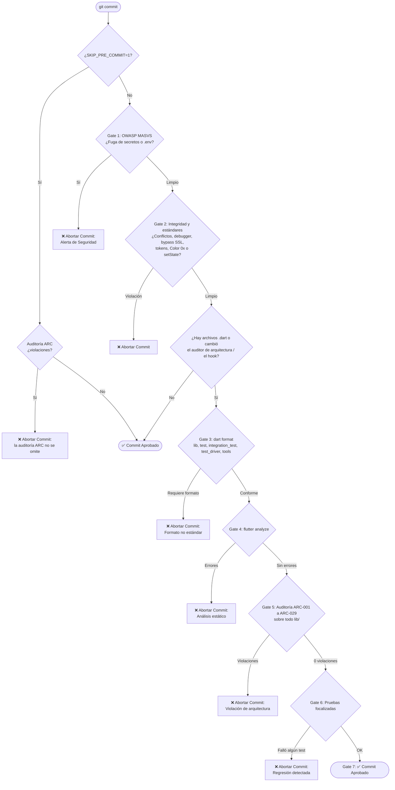

# 🪝 Git Hooks y Quality Gates Pre-Commit

En **ZAS**, la calidad, mantenibilidad y seguridad del software no se delegan únicamente a los pipelines remotos de CI/CD, sino que se aseguran desde la primera línea de código en la máquina de cada desarrollador.

Para ello, disponemos de un sistema de **Git Hooks versionados** en el directorio `.githooks/` que valida automáticamente cada commit frente a estándares internacionales de ingeniería de software.

!!! tip "¿Máquina nueva o primera vez en el proyecto?"
    Sigue [Configurar los hooks de zas desde cero](configurar_hooks_desde_cero.md): instalación de fvm, gitleaks y osv-scanner, verificación paso a paso, cómo funciona el auditor ARC y un prompt listo para un agente de IA.

---

## 🌐 Normas Internacionales Aplicadas

El hook `pre-commit` implementa compuertas de calidad (**Quality Gates**) alineadas con:

1. **ISO/IEC 25010 (Software Product Quality):**
   - **Mantenibilidad y Analizabilidad:** Análisis estático riguroso (`flutter analyze`) y formato estricto oficial (`dart format`).
   - **Integridad de Código:** Detección de marcadores de conflicto de fusión residuales (`<<<<<<<`, `=======`, `>>>>>>>`) y artefactos de depuración (`debugger()`).
2. **OWASP MASVS (Mobile Application Security Verification Standard):**
   - **MASVS-STORAGE-1 / CRYPTO:** Prevención absoluta de fugas de credenciales, claves privadas (certificados PEM, RSA o SSH), certificados o archivos de entorno (`.env*`, `*.keystore`, `*.jks`, `key.properties`).
   - **MASVS-NETWORK:** Prohibición estricta de bypass de certificados SSL (`badCertificateCallback => true`).
3. **ISO/IEC 29119 (Software Testing):**
   - Ejecución focalizada de pruebas unitarias asociadas a los archivos modificados antes de confirmar el commit.
4. **Arquitectura ZAS (ARC-001 a ARC-029):**
   - Auditoría de Clean Architecture sobre **todo `lib/`** con `scripts/script_audit_architecture.dart`: aislamiento de capas (ARC-001), sin `setState()` en pantallas (ARC-002), vistas sin cubits (ARC-003), sin `http://` (ARC-004) y sin force-unwrap `!` en el dominio (ARC-005). Regla completa: `.agents/rules/rule_arc_zero_tolerance.md`.
5. **Sistema de diseño (DTCG):**
   - Tres barreras de tokens: sin tokens legacy, sin `Color(0x…)` fuera de `app_colors.dart` y sin nombres ordinales en `AppColors`.

---

## 🧩 Estructura: hooks comunes y reglas de ZAS

`pre-commit`, `pre-push` y `commit-msg` son los **hooks comunes del kit de agentes** (se comparten entre proyectos desde `mcp-ia/kit-agentes/hooks`; su versión instalada queda en `.githooks/kit_hooks.json`). Los comunes ya traen **gitleaks** (pre-commit, Gate 1, con `.gitleaks.toml`) y **osv-scanner** (pre-push, archivos de bloqueo de la raíz). Las reglas propias de ZAS viven aparte y el hook común las llama:

| Archivo | Qué hace |
|---|---|
| `.githooks/pre-commit.local` | Gate 5: tokens DTCG, `Color(0x…)`, `Colors.X`, ARC-002, `verify_legacy_tokens.sh` y la auditoría ARC-001 a ARC-029. |
| `.githooks/obligatorio.sh` | Auditoría ARC que se ejecuta incluso con `SKIP_PRE_COMMIT=1`. |
| `.githooks/pre-push.local` | Después de `flutter analyze` y la suite: ramas protegidas, versión de Flutter, `pubspec.lock`, auditoría ARC, cobertura global (54 %) y de las líneas cambiadas (80 %). |

Para una regla nueva de ZAS edita `pre-commit.local`. Si mejoras un hook común, compártelo con `python3 <mcp-ia>/kit-agentes/kit_agentes.py hooks . --compartir` (y commit y push de mcp-ia); para recibir mejoras: `hooks . --actualizar`.

---

## ⚡ Instalación y Activación

Los hooks están almacenados y versionados dentro de la carpeta `.githooks/` del repositorio. Para activarlos en tu entorno local, solo requieres ejecutar un comando:

=== "Instalación Automática (Recomendado)"

    ```bash
    sh scripts/setup_hooks.sh
    ```

=== "Instalación Manual"

    ```bash
    # 1. Otorgar permisos de ejecución al hook
    chmod +x .githooks/pre-commit
    
    # 2. Indicar a Git que use la carpeta .githooks
    git config core.hooksPath .githooks
    ```

!!! success "Listo para usar"
    A partir de este momento, cada vez que ejecutes `git commit`, las compuertas de calidad se ejecutarán de forma transparente en tu terminal.

---

## 🔄 Flujo de Ejecución (Quality Gates)



---

## 🛡️ Detalle de las Compuertas de Calidad

### [Gate 1] Seguridad OWASP MASVS: Secretos y Credenciales
- **Qué valida:** Impide que se agreguen al commit archivos confidenciales como `.env`, `.env.dev`, `.env.test`, `*.jks`, `*.keystore`, `key.properties`, `id_rsa`, `*.pem`, `*.key` o `serviceAccountKey*.json`. Además, escanea el contenido de los archivos preparados en busca de bloques de claves privadas RSA/OPENSSH.
- **Acción ante error:** Retirar el archivo del área de preparación con:
  ```bash
  git reset HEAD <archivo-sensible>
  ```

### [Gate 2] Integridad de Código y Estándares ZAS
Revisa los archivos preparados:

- **Marcadores de conflicto:** residuos de merge incompletos (`<<<<<<< HEAD`, `=======`, `>>>>>>>`).
- **Depuración:** llamadas huérfanas a `debugger()`.
- **Bypass SSL:** `badCertificateCallback` que devuelve `true`.
- **Barrera de tokens 1:** tokens legacy u ordinales (`septenary`, `senary`, `brigthGreen`…). Ver `docs/design_tokens.md`.
- **Barrera de tokens 2:** `Color(0x…)` fuera de `app_colors.dart` y `app_theme.dart`.
- **Barrera de tokens 3:** nombres ordinales (`color1`, `primary2`…) en `app_colors.dart`.
- **Regla ARC-002:** `setState()` dentro de `lib/presentation/screens/`, salvo la excepción documentada de `splash/splash_screen.dart`.

### [Gate 3] Formato Oficial Dart (`dart format`)
- **Qué valida:** Ejecuta `dart format --set-exit-if-changed` sobre las carpetas **completas** `lib`, `test`, `integration_test`, `test_driver` y `tools` (las que existan). No se limita a los archivos preparados.
- **Acción ante error:** Formatea y vuelve a agregar los archivos:
  ```bash
  dart format lib test
  git add <archivos-indicados>
  ```

### [Gate 4] Análisis Estático y Linter (`flutter analyze`)
- **Qué valida:** Ejecuta el análisis estático de todo el proyecto según `analysis_options.yaml` (tipos estrictos, null safety, imports no usados, buenas prácticas).
- **Acción ante error:** Corrige las advertencias o errores reportados.

### [Gate 5] Auditoría de Arquitectura (ARC-001 a ARC-029)
- **Qué valida:** Ejecuta `dart run scripts/script_audit_architecture.dart` sobre **todo `lib/` en disco**, no solo sobre lo preparado. **Una sola violación en cualquier archivo bloquea el commit**, aunque el commit no toque ese archivo.
- **Reglas:** la lista completa (DDD por módulo, capa de diseño agnóstica, datos sensibles en los registros…) y cómo funcionan la línea base y las excepciones están en [Configurar los hooks de zas desde cero](configurar_hooks_desde_cero.md#6-como-funciona-el-auditor-de-arquitectura).
- **No se puede omitir:** se ejecuta también con `SKIP_PRE_COMMIT=1`.
- **Si cambian `scripts/script_audit_architecture.dart`, su prueba o este hook,** la auditoría se ejecuta aunque no haya otros archivos `.dart`.
- **Acción ante error:** Ejecuta el script para ver el detalle y corrige la violación. Nunca agregues excepciones ni modifiques el script para que pase.

### [Gate 6] Pruebas Unitarias Focalizadas (`flutter test`)
- **Qué valida:**
  - Si modificaste `lib/.../<modulo>.dart`, ejecuta `test/.../<modulo>_test.dart` si existe.
  - Si modificaste un archivo `test/*_test.dart`, lo ejecuta.
  - Si cambiaron el auditor de arquitectura o el hook, ejecuta además `test/scripts/script_audit_architecture_test.dart`, que fija qué debe detectar ARC-005.
- **Limitación:** no ejecuta la suite completa. Ejecútala antes de abrir un merge request:
  ```bash
  flutter test
  ```

### [Gate 7] Aprobación Final
Si todos los gates pasan, el commit se confirma.

---

## 🚀 Buenas Prácticas y Consejos

### Rendimiento
Los gates 1, 2 y 6 actúan sobre los archivos preparados (`git diff --cached --name-only --diff-filter=ACM`). En cambio, los gates 3, 4 y 5 recorren el proyecto completo: según el equipo, un commit con archivos Dart puede tardar desde unos segundos hasta más de un minuto.

### Excepciones y Bypass de Emergencia
`SKIP_PRE_COMMIT=1` omite los gates, **salvo la auditoría de arquitectura**, que se ejecuta igual y bloquea el commit si encuentra violaciones:

```bash
SKIP_PRE_COMMIT=1 git commit -m "hotfix: corrección de emergencia"
```

`git commit --no-verify` desactiva todo el hook por diseño de git. **Está prohibido usarlo** (`.agents/rules/rule_arc_zero_tolerance.md`).

!!! warning "Sin CI efectivo"
    Hoy los jobs de `.gitlab-ci.yml` están en `when: never` por falta de minutos de cómputo, así que un commit hecho con `--no-verify` **no** se revisa en ningún pipeline. Una violación de arquitectura que entre así bloqueará el siguiente commit de cualquier persona del equipo hasta que se corrija.
